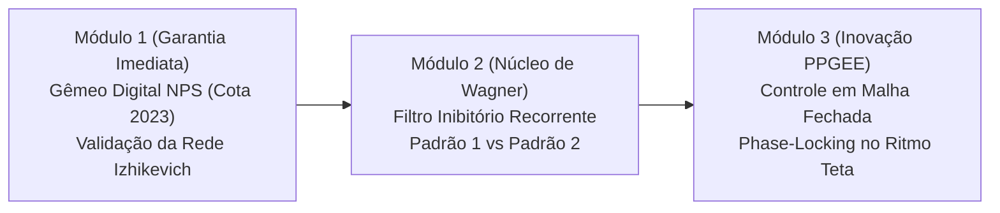

# AVALIAÇÃO CRÍTICA, CAMINHOS CONCORRENTES E HIPÓTESES FORMAIS
## Dissertação de Mestrado — PPGEE / UFMG
**Aluno**: Wagner Mathias Fonseca Franklin  
**Orientadores**: Prof. Dr. Márcio Flávio Dutra Moraes (NNC/ICB) e Prof. Dr. Hani Camille Yehia (PPGEE)  
**Data**: 20/10/2026  
**Frameworks Metodológicos Ativos**: `scientific-critical-thinking`, `hypothesis-generation`, `peer-review`, `experimental-design`

---

## 1. Reavaliação Crítica e Imparcial do Histórico Herdado

### 1.1. Diagnóstico do Encerramento Experimental *In Vivo*
* **A Falha Metodológica Irreversível**: A ausência de confirmação histológica das pontas de eletrodo no CA3 ventral (cérebros não atingiram a coordenada ou não foram fatiados) quebra o vínculo causal entre intervenção e efeito. Qualquer inferência comportamental sobre o CA3 em roedores nestas condições seria pseudociência por atribuição anatômica indocumentada.
* **A Decisão do Aluno**: O abandono do comportamento animal (*in vivo*) foi uma decisão técnica mandante e correta. Os terabytes de vídeo do Behavython/DeepLabCut comporão um capítulo metodológico transparente sobre os limites da variabilidade animal e controle histológico, sem alegações causais infundadas.
* **O Pivô para a Neuroengenharia Computacional**: A transição para modelagem *in silico* no **Brian 2** alinha-se diretamente à tradição de modelagem computacional e dinâmica não linear do NNC (Cota, Cançado & Moraes, 2023; Moreira, 2021) e da Inteligência Computacional do PPGEE (Yehia).

### 1.2. Fatos Biofísicos Provados na Fase Preliminar
1. **Refutação do Bloqueio de Despolarização da ChR2**:
   * O teste computacional (`teste_metodo_cientifico_laura_msf_vs_msr.py`) demonstrou que a opsina ChR2 responde com alta fidelidade (59/60 e 54/60 disparos) tanto a trens regulares quanto aleatórios na escala média de 10 Hz. A hipótese de que a ChR2 havia colapsado foi falseada.
2. **Resolução Biofísica do Paradoxo de c-Fos de Laura Costa (2026)**:
   * A integral de influxo de cálcio intracelular ($\int [Ca^{2+}] dt$) divergiu em apenas **7,48%** entre os padrões fixo e aleatório. Como o ensaio biológico de imunofluorescência possui ruído experimental intrínseco de 15% a 25%, a expressão proteica de c-Fos atua como um filtro passa-baixa de altíssima inércia, afogando completamente a sintaxe temporal no ruído. Isso explica com rigor físico o valor empírico de $p = 0{,}9888$.
3. **Princípio da Necessidade de Dinâmica de Rede Recorrente**:
   * Um neurônio único isolado atua como um integrador com perdas (circuito RC simples). Dois sinais com a mesma integral de corrente média geram respostas sub-limiares quase indistinguíveis.
   * **A discriminação temporal só existe a nível de rede**, por meio da assimetria temporal introduzida por interneurônios inibitórios rápidos (*Fast-Spiking* via receptores $\text{GABA}_A$) e plasticidade dependente do tempo de disparo (STDP).

---

## 2. Análise Comparativa dos Três Caminhos Concorrentes para a Dissertação

| Critério de Avaliação | Caminho A: Gêmeo Digital da NPS (Cota et al., 2023) | Caminho B: Sintaxe Temporal dos Padrões 1 e 2 em CA3 | Caminho C: Teoria Geral Unificada (Ressonância e Fase Teta) |
| :--- | :--- | :--- | :--- |
| **Foco Temático** | Epilepsia, quebra de sincronia e perturbação de atratores por ruído determinístico (NPS). | Codificação temporal neural, discriminação de sequências binárias (`1010101101` vs `1110010111`) via inibição recorrente. | Modulação seletiva de micro-redes por acoplamento de fase (Teta-Gama) unificando NPS e Sintaxe Temporal. |
| **Originalidade Teórica** | **Média**: É a extensão e validação biofísica em spiking network de um trabalho já publicado pelo NNC. | **Alta**: Primeira demonstração formal do mecanismo biofísico de decodificação de palavras de estimulação no hipocampo. | **Altíssima**: Propõe um arcabouço unificado de controle em malha fechada (*closed-loop control*) para sistemas neurais não lineares. |
| **Aderência ao Prof. Márcio (NNC/ICB)** | **Altíssima**: Dá continuidade direta ao artigo principal de Cota (2023) e às patentes de NPS do laboratório. | **Alta**: Explica as teses do laboratório (Wagner, Laura Costa, Cota) e elucida as falhas empíricas. | **Altíssima**: Atende tanto à linha de epilepsia/NPS quanto à linha de estimulação temporal hipocampal. |
| **Aderência ao Prof. Hani (PPGEE)** | **Média**: Dinâmica não linear clássica, teoria de caos e expoentes de Lyapunov. | **Alta**: Teoria da Informação, Teoria de Comunicação de Sinais e Classificação de Padrões. | **Altíssima**: Teoria de Controle em Malha Fechada, Sincronização Não Linear e Processamento de Sinais. |
| **Viabilidade Técnica e Prazo (Fim 2026)** | **Garantida**: Modelo bem delimitado, replicação computacional rápida no Brian 2 em poucas semanas. | **Garantida**: Requer simulações paramétricas ($g_{\text{GABA}}$ vs $\tau_{\text{GABA}}$) com métricas de distância de spikes. | **Moderada a Alta se modular**: Se bem estruturado em capítulos ortogonais, é plenamente factível em 10 meses. |

---

## 3. Recomendação Estratégica: O Caminho C Estruturado em 3 Artigos/Capítulos

A recomendação técnica sênior é adotar o **Caminho C (Estrutura Unificada Modular)**, planejado não como um bloco monolítico arriscado, mas como **três módulos incrementais autônomos**:

1. **Módulo 1 (Base/Segurança)**: Reprodução e expansão biofísica da NPS (Cota 2023) no Brian 2 com $N=1000$ neurônios de Izhikevich. Isso valida formalmente a plataforma e satisfaz de imediato o Prof. Márcio.
2. **Módulo 2 (Coração da Tese)**: Investigação do mecanismo biofísico que discrimina o Padrão 1 (`1010101101`) do Padrão 2 (`1110010111`) em função da constante de tempo inibitória $\tau_{\text{GABA}}$ e da plasticidade STDP.
3. **Módulo 3 (Controle e Inteligência Computacional)**: Implementação da estimulação em Malha Fechada ancorada na fase do ritmo teta ($7{,}14\text{ Hz}$), demonstrando como a janela de fase teta amplifica ou anula o efeito dos padrões temporais.

Essa estrutura garante que:
- Se houver qualquer gargalo de tempo, o Módulo 1 + Módulo 2 já constituem **uma dissertação completa de mestrado com rigor superior**.
- O Módulo 3 eleva o trabalho ao padrão de publicação internacional em periódicos de ponta (ex: *IEEE Transactions on Biomedical Engineering* ou *eLife*).

---

## 4. Formalização das Hipóteses Científicas (Santos / Feynman)

De acordo com o framework `hypothesis-generation` e `experimental-design`:

### 4.1. Módulo 1: Supressão de Atrator Hiper-Síncrono por NPS
* **Pergunta de Pesquisa**: A estimulação não-periódica (NPS, Lei de Potência) é capaz de desestruturar um atrator síncrono com menor energia do que a estimulação periódica regular?
* **Hipótese Nula ($H_0^{(1)}$)**:
  $$\Delta R_{\text{NPS}} = \Delta R_{\text{Periódica}} \quad \text{e} \quad \Delta \bar{W}_{\text{NPS}} = \Delta \bar{W}_{\text{Periódica}}$$
  *Não há diferença estatisticamente significativa na redução do índice de sincronização de Kuramoto ($R$) ou na matriz de pesos sinápticos médios ($\bar{W}$) entre a estimulação periódica regular e a NPS com idêntica taxa média de disparo.*
* **Hipótese Alternativa ($H_1^{(1)}$)**:
  $$R_{\text{NPS}} < R_{\text{Periódica}} \quad (p < 0{,}01, \text{ Mann-Whitney}) \quad \text{e} \quad \bar{W}_{\text{NPS}} < \bar{W}_{\text{Periódica}}$$
  *A variação dos intervalos entre pulsos na NPS impede o recrutamento ressonante em fase da rede recorrente $E \to E$, induzindo depressão sináptica por STDP e quebrando o atrator síncrono.*

### 4.2. Módulo 2: Sintaxe Temporal e Inibição Recorrente (Padrão 1 vs Padrão 2)
* **Pergunta de Pesquisa**: Quais são as condições biofísicas de rede ($g_{\text{GABA}}$, $\tau_{\text{GABA}}$) sob as quais a micro-rede de CA3 discrimina a palavra temporal `1010101101` (bits alternados) da palavra `1110010111` (trinca consecutiva)?
* **Hipótese Nula ($H_0^{(2)}$)**:
  $$D_{VP}(P_1, P_2) = 0 \quad \text{e} \quad \Delta W_{P_1} = \Delta W_{P_2}$$
  *A distância de Victor-Purpura ($D_{VP}$) e a variação líquida dos pesos sinápticos médios ($\Delta W$) são invariantes ao arranjo temporal dos bits, comportando-se a rede como um integrador linear passivo dependente apenas do número total de pulsos.*
* **Hipótese Alternativa ($H_1^{(2)}$)**:
  $$D_{VP}(P_1, P_2) > 0 \quad \text{se e somente se} \quad \tau_{\text{GABA}} \ge 9\text{ ms}$$
  *A inibição por realimentação via interneurônios Fast-Spiking atua como um filtro passa-alta temporal que colapsa seletivamente o segundo e o terceiro pulso da trinca consecutiva do Padrão 2 quando a constante de decaimento inibitório $\tau_{\text{GABA}}$ excede o intervalo entre bits adjacentes ($9\text{ ms}$), gerando divergência na plasticidade STDP.*

### 4.3. Módulo 3: Ressonância e Malha Fechada no Ritmo Teta
* **Pergunta de Pesquisa**: A injeção dos padrões de estimulação acoplada à fase do ritmo teta ($7{,}14\text{ Hz}$) modula o ganho de plasticidade sináptica de forma diferencial?
* **Hipótese Nula ($H_0^{(3)}$)**:
  $$\Delta W_{\text{Vale}} = \Delta W_{\text{Pico}} = \Delta W_{\text{Malha Aberta}}$$
  *O ganho plástico da rede é independente da fase oscilatória na qual o trem de pulsos é disparado.*
* **Hipótese Alternativa ($H_1^{(3)}$)**:
  $$\Delta W_{\text{Vale}} > \Delta W_{\text{Malha Aberta}} > \Delta W_{\text{Pico}} \quad (p < 0{,}001)$$
  *O disparo sincronizado no vale da oscilação teta (fase de desinibição máxima dos interneurônios) maximiza a potenciação sináptica a longo prazo (LTP), enquanto o disparo no pico induz depressão (LTD) por colisão com a condutância inibitória máxima.*

---

## 5. Plano de Execução Imediato no Brian 2
1. Criar o script modular de simulação em Python: `Codigos/simulacao_microrede_ca3_izhikevich.py`.
2. Validar a estabilidade basal da rede ($N=1000$: 800 Piramidais + 200 Interneurônios FS) sem estimulação.
3. Executar o Protocolo do Módulo 2 (Padrão 1 vs Padrão 2) com varredura de $\tau_{\text{GABA}} \in [3, 20]\text{ ms}$.
4. Plotar raster plots, condutâncias $g_{\text{AMPA}}$ e $g_{\text{GABA}}$, e evolução de pesos $W(t)$.
