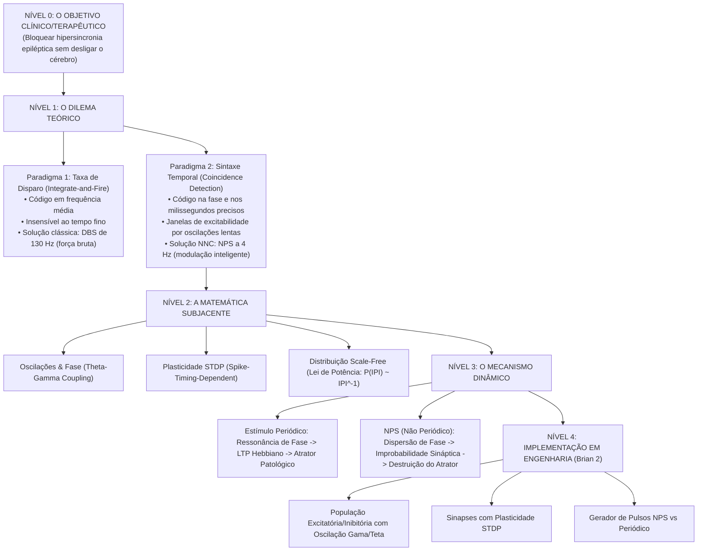

# Estudo Dirigido e Anatômico: Cota, Cançado & Moraes (2023)
## "On temporal scale-free non-periodic stimulation and its mechanisms as an infinite improbability drive of the brain's functional connectogram"
*Frontiers in Neuroinformatics*, 17:1173597. doi: 10.3389/fninf.2023.1173597

---

## 1. Visão Global: O que este artigo defende e por que ele existe?

Este artigo não é apenas uma revisão de literatura; é o **manifesto teórico e conceitual do laboratório do Prof. Márcio (NNC/UFMG) e do Prof. Vinícius Cota**. Ele sintetiza mais de 15 anos de pesquisa (desde a tese de 2009 de Cota et al.) que culminou na criação da **NPS (*Non-periodic Stimulation*)**, uma tecnologia patenteada pelo grupo.

### O Paradoxo que o Artigo Resolve:
Historicamente, a estimulação cerebral profunda (DBS) para Parkinson ou epilepsia utiliza **alta frequência fixa contínua** (100 a 130 Hz). 
- *Problema do DBS clássico*: Consome uma quantidade enorme de energia (descarrega a bateria do gerador de pulsos implantável - IPG em 3 a 5 anos, exigindo cirurgia de troca), lesiona tecido por saturação eletroquímica, causa tolerância/habituação biológica e age como uma "lesão funcional" (desliga a área por despolarização em bloco).
- *A descoberta do grupo*: Aplicando pulsos com frequência média muito baixa (apenas **4 pulsos por segundo**, ou seja, 4 Hz em média) — gastando uma fração mínima de energia —, eles conseguiram um efeito anticonvulsivante superior ao da estimulação regular de alta frequência, **desde que os intervalos entre os pulsos (IPI) sigam uma distribuição livre de escala (Power-Law / Lei de Potência)**.

### A Pergunta Central do Artigo:
> *Se a quantidade de pulsos por segundo é minúscula (4 Hz), por que a estimulação periódica de 4 Hz piora as crises (é pró-convulsiva), enquanto a estimulação não-periódica com lei de potência de 4 Hz suprime as crises (é anticonvulsivante)?*

A resposta exige uma mudança radical de paradigma: sair da visão clássica de **Integrar-e-Disparar (Integrate-and-Fire / Taxa de Disparo)** e entrar no paradigma da **Detecção de Coincidência e Sintaxe Temporal (Coincidence Detection / Phase Coding)**.

---

## 2. Leitura Guiada Seção por Seção (Comentada)

### Seção 1: Introdução — Das Raias Elétricas de Roma ao DBS Moderno
- **O que diz**: Relata a história da estimulação elétrica desde o uso de peixes-elétricos na Roma antiga até Penfield mapeando o homúnculo motor. Mostra que a medicina sempre usou eletricidade por tentativa e erro antes de entender a teoria ("Quem ama a prática sem teoria é como o marinheiro que entra no navio sem leme e bússola", citando Leonardo da Vinci).
- **Comentário Crítico**: Os autores preparam o terreno para dizer: a neuroestimulação clínica está estagnada no modelo de "força bruta" (aumentar voltagem e frequência fixa) porque se baseia em uma teoria do cérebro defasada há décadas.

### Seção 2.1: O Paradigma Clássico — "Integrate-and-Fire" (Sherrington & McCulloch-Pitts)
- **Conceito Básico**:
  1. O neurônio recebe potenciais pós-sinápticos analógicos (EPSPs e IPSPs).
  2. Ele soma algebricamente essas voltagens no soma (integração espacial e temporal).
  3. Se a voltagem atinge o limiar, dispara um potencial de ação digital ("tudo ou nada").
  4. A informação é codificada puramente na **frequência de disparo** (taxa de disparo: quanto mais forte o estímulo, mais disparos por segundo).
- **A Falha Desse Modelo (The Binding Problem & Latência)**:
  - Se cada sinapse tivesse que integrar analogicamente dezenas de pulsos para só então decidir disparar, uma cadeia de 5 sinapses sensório-motoras levaria centenas de milissegundos. Um animal não conseguiria fugir de um predador a tempo.
  - Além disso, como o cérebro conecta a cor vermelha, a forma redonda e o movimento de uma bola ("feature binding") em áreas visuais separadas se a única informação é uma frequência média de disparos? O modelo clássico falha em explicar isso.

### Seção 2.2: O Novo Paradigma — "Coincidence Detection" e Sintaxe Temporal
- **Conceito Chave**: Os neurônios corticais operam muito mais como **detectores de coincidência** do que como integradores lentos.
- **Como Funciona**: 
  - Se 10 sinapses disparam simultaneamente em uma janela temporal minúscula de 2 a 5 milissegundos, o neurônio dispara imediatamente. Se essas mesmas 10 sinapses dispararem espaçadas em 50 milissegundos, o vazamento da membrana dissipa a voltagem e o neurônio não dispara.
  - Portanto, a informação não está em "quantos pulsos por segundo" o neurônio emite, mas em **"quando exatamente" os pulsos ocorrem em relação às oscilações de fundo do cérebro**.
- **Comunicação por Coerência (Fries) e Fase das Ondas Cerebrais**:
  - As oscilações lentas (como Teta, 4–8 Hz) abrem "janelas de excitabilidade" periódicas. Durante o pico da onda, os neurônios estão despolarizados e prontos para disparar; no vale da onda, estão inibidos.
  - Se a Região A e a Região B sincronizam suas oscilações (coerência de fase), a mensagem de A chega a B exatamente durante o pico da excitabilidade de B. A comunicação é aberta. Se as fases se desencontram, a comunicação é bloqueada.
  - **Synfire Chains (Abeles) e Policronização (Izhikevich)**: Redes neurais ativam sequências espaçotemporais extremamente precisas de disparos (como acordes musicais tocados em ordem exata: "cortical songs").

### Seção 3: A Dimensão Temporal na Eletroestimulação
- **O que diz**: Até os anos 2000, engenheiros e médicos só ajustavam 3 parâmetros de estimulação:
  1. Amplitude da corrente ($\mu\text{A}$ ou $\text{mA}$);
  2. Duração da fase do pulso ($\mu\text{s}$);
  3. Frequência fixa de repetição ($Hz$).
- **A Virada**: Peter Tass (Stanford) e Warren Grill (Duke) começaram a mostrar que a **regularidade temporal** dos pulsos é uma variável independente crucial:
  - Peter Tass criou o *Coordinated Reset (CR)*: disparar pulsos dessincronizados em diferentes subpopulações para quebrar o ritmo patológico do Parkinson.
  - Grill propôs a hipótese da "lesão informacional": o DBS de alta frequência satura o neurônio e destrói o tráfego patológico através de ruído regular.

### Seção 4: O Mecanismo da NPS — "O Gerador de Improbabilidade Infinita"
Esta é a parte central do artigo. Os autores usam uma metáfora de ficção científica (do livro *O Guia do Mochileiro das Galáxias*, de Douglas Adams): a nave movida a "Gerador de Improbabilidade Infinita", que viaja pelo espaço gerando eventos aleatórios improváveis.

#### Por que a Epilepsia é um "Atrator Hipersincrônico"?
- Na dinâmica não linear, um **atrator** é um estado para o qual o sistema converge e fica preso.
- Em um cérebro saudável, o conectograma funcional é dinâmico e flexível: diferentes grupos neurais se acoplam e desacoplam a cada milissegundo para pensar, ver, agir.
- Na epilepsia, a rede cai em uma armadilha dinâmica: um circuito hiper-conectado começa a reverberar. Cada ciclo recruta mais neurônios. Pela regra de Hebb e STDP (*Spike-Timing-Dependent Plasticity*), neurônios que disparam juntos fortalecem suas sinapses. O atrator torna-se invencível $\to$ Crise epiléptica generalizada.

#### O que a Estimulação Periódica (Fixa) Faz? (Figura 1D, 1E e Figura 2A)
- Se você injeta pulsos regulares (ex: a cada 250 ms = 4 Hz cravados), cada pulso atinge a rede em uma relação de fase constante.
- O pulso recruta **sempre os mesmos neurônios na mesma ordem sequencial**.
- Pelo mecanismo de STDP, as conexões entre esses neurônios específicos são reforçadas a cada pulso.
- *Consequência*: A estimulação periódica atua como um maestro ditando o ritmo, **arrastando (*entrainment*) a rede para o atrator patológico**. No modelo PTZ, a estimulação periódica acelera as convulsões.

#### O que a NPS (Scale-Free / Lei de Potência) Faz? (Figura 1C e Figura 2B)
- Na NPS, o intervalo entre um pulso e o próximo ($IPI$) é sorteado a partir de uma distribuição matemática de **Lei de Potência** ($P(IPI) \propto IPI^{-1}$), variando em tempo real.
- Cada pulso cai em uma fase diferente da oscilação lenta da rede.
- Como o estado de excitabilidade da rede muda a cada milissegundo:
  - O Pulso 1 ativa o subgrupo neural verde.
  - O Pulso 2 ativa o subgrupo neural laranja.
  - O Pulso 3 ativa o subgrupo neural azul.
  - O Pulso 4 ativa o subgrupo neural vermelho.
- A ordem e a combinação **nunca se repetem**.
- *Consequência Termodinâmica e Sináptica*:
  1. **STDP é neutralizado**: Para haver LTP (fortalecimento sináptico), é necessária repetição consistente de pré-antes-de-pós. Com pulsos aleatórios, a janela STDP experimenta tanto intervalos positivos quanto negativos, gerando depressão sináptica (LTD) ou homeostase.
  2. **Competição pelo substrato neural**: Os neurônios recrutados pela NPS ficam em período refratário por alguns milissegundos, impedindo que a onda epileptogênica os recrute.
  3. **Destruição do Atrator**: A rede é impedida de convergir para a hipersincronia. O atrator patológico é fragmentado com consumo mínimo de energia (média de 4 Hz).

---

## 3. As Figuras do Artigo Explicadas em Detalhe

### 
- **Painel A**: Mostra nós corticais coloridos. A probabilidade de um nó disparar depende de sua cor corresponder à fase atual da onda oscilatória subjacente.
- **Painel B**: Uma oscilação lenta (ex: Teta a 4–8 Hz) sincroniza nós distantes, criando uma rede de "Mundo Pequeno" (*Small-World Network*) para transferir pacotes de informação.
- **Painel C**: Um trem de disparos temporais aleatórios atinge a rede. Como cada disparo ocorre em um ponto de fase distinto, cada pulso percorre um caminho sináptico completamente diferente.
- **Painel D & E**: Um trem periódico e estereotipado repete o mesmo padrão de fase ciclo após ciclo. O circuito se fecha em reverberação, a plasticidade STDP entra em ação e grava um engrama patológico rígido.

### 
- **Painel Superior (A - Periodic ES)**:
  - Frequência fixa (IPI constante = $T$).
  - Recrutamento repetitivo do mesmo circuito $\to$ Aumento dos pesos sinápticos $\to$ Formação de assinaturas eletrográficas estereotipadas $\to$ **Ictogênese (Disparo de crises)**.
- **Painel Inferior (B - Temporally Complex ES / NPS)**:
  - Intervalos entre pulsos sorteados via Lei de Potência unitária ($\alpha = 1$).
  - Recrutamento caótico/disperso de microcircuitos $\to$ Queda da sincronia $\to$ Desacoplamento sináptico $\to$ **Ação Anticonvulsivante Robusta com preservação das funções fisiológicas**.

---

## 4. O Mapa Mental de Conceitos (Aplicação das 20 Regras do SuperMemo)

Para você dominar este artigo e o curso do Wulfram Gerstner sem se perder em fórmulas soltas, organize o conhecimento nesta estrutura hierárquica estrita (do macro para o micro):

### Como Conectar Isso ao Curso do Gerstner (*Neuronal Dynamics*):
O curso do Gerstner assusta porque ele deriva toda a biofísica de canais iônicos antes de dizer para onde está indo. Quando você assistir às aulas ou ler o livro do Gerstner, procure **apenas** as peças que alimentam este mapa:
1. **Capítulo de Leaky Integrate-and-Fire (LIF)**: Entenda a constante de tempo da membrana $\tau_m = R C$. É ela que define a "janela de coincidência" ($\sim 10\text{ a }20\text{ ms}$). Se dois pulsos caem dentro de $\tau_m$, eles somam; se caem fora, decaem.
2. **Capítulo de Populações e Oscilações (PING - Pyramidal Interneuron Network Gamma)**: Veja como a interação entre neurônios excitatórios e inibitórios gera o ritmo de fundo natural.
3. **Capítulo de STDP**: Veja a curva exponencial assimétrica ($\Delta w$ em função de $\Delta t = t_{\text{post}} - t_{\text{pre}}$). O artigo do Prof. Márcio depende 100% dessa curva para explicar por que a estimulação periódica vicia o circuito e a NPS desfaz o vício.

---

## 5. Como Implementar Este Experimento no Brian 2

Você não precisa inventar nada do zero. O próprio repositório oficial do Brian 2 possui os blocos canônicos exatos para montar esse teste.

### Os Três Exemplos Nativos do Brian 2 Utilizados:
1. **Rede de Brunel (2000)** (`examples/Brunel_2000.py`): O modelo padrão de rede cortical/subcortical com 80% de neurônios excitatórios e 20% inibitórios, que exibe estados assíncronos e estados oscilatórios sincronizados dependendo do balanço de inibição.
2. **Sinapses STDP de Song, Miller & Abbott (2000)** (`examples/synapses/STDP.py`): O modelo biofísico padrão de plasticidade dependente do tempo de disparo.
3. **Gerador de Espículas Arbitrárias** (`SpikeGeneratorGroup`): O bloco do Brian 2 que permite injetar qualquer sequência temporal de pulsos calculada externamente.

### O Roteiro Experimental *In Silico*:
1. **Rede Neural**:
   - $N_E = 800$ neurônios piramidais (excitatórios).
   - $N_I = 200$ interneurônios (inibitórios).
   - Conectividade recorrente com probabilidade $p = 0.05$.
   - Sinapses $E \to E$ equipadas com STDP.
2. **Perturbação Patológica (Modelo de Epilepsia)**:
   - Reduz-se temporariamente a condutância inibitória $g_{GABA}$ ou injeta-se uma corrente despolarizante constante na rede, empurrando-a para o atrator hipersincrônico (disparos massivos em rajada).
3. **Braço A: Estimulação Periódica**:
   - Pulso injetado a cada $250\text{ ms}$ cravados (4.0 Hz).
   - *Resultado esperado*: As sinapses $E \to E$ sofrem LTP intenso, os neurônios travam na mesma fase, e a rede sustenta o disparo síncrono.
4. **Braço B: NPS (Lei de Potência)**:
   - Os mesmos 4 pulsos por segundo em média, mas com $IPI$ amostrado de $P(IPI) \propto IPI^{-1}$ (entre $50\text{ ms}$ e $1000\text{ ms}$).
   - *Resultado esperado*: As sinapses $E \to E$ têm seus pesos dispersos, as fases são dessincronizadas a cada pulso, e a hipersincronia é bloqueada.
