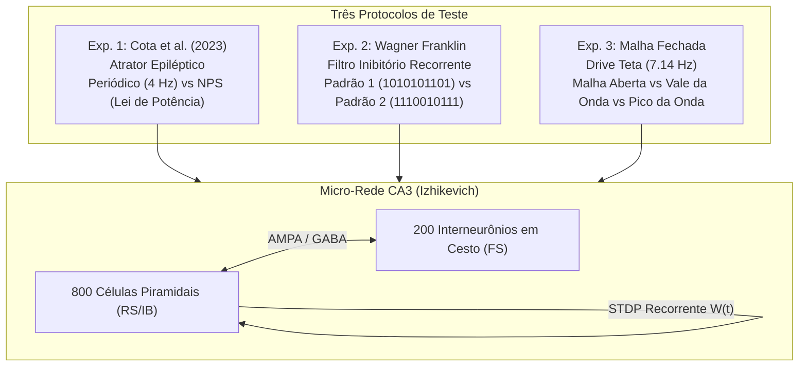

# PLANO METODOLÓGICO EXPERIMENTAL: ESTUDO DE REDE RECORRENTE NO BRIAN 2 COM O MODELO DE IZHIKEVICH (2003)
## Investigação Biofísica de NPS (Cota 2023), Padrões Temporais (Wagner) e Malha Fechada

---

## 1. Justificativa Teórica da Escolha do Modelo de Izhikevich

Na modelagem de redes neurais no Brian 2, existem três opções de abstração:
1. **Hodgkin-Huxley (HH)**: 4 equações não lineares por célula, passo de integração $dt \le 0{,}02\text{ ms}$. Excelente para cinética de canais e fotocorrente de opsinas, mas inviável computacionalmente para redes recorrentes densas de milhares de neurônios simuladas por minutos.
2. **Leaky Integrate-and-Fire (LIF)**: 1 equação linear. Incapaz de reproduzir disparo em rajada (*bursting*), ressonância sub-limiar ou adaptação de frequência.
3. **Izhikevich (2003)**: **O ponto de equilíbrio ótimo da Engenharia**.
   * Consiste em apenas 2 equações diferenciais acopladas ($v$ e $u$).
   * Permite passo de integração maior ($dt = 0{,}1\text{ ms}$ a $0{,}5\text{ ms}$).
   * Reproduz todas as classes eletrofisiológicas de CA3: células piramidais com disparo em rajada (*Intrinsically Bursting* ou *Regular Spiking*) e interneurônios GABAérgicos em cesto com disparo rápido sem adaptação (*Fast-Spiking*).

---

## 2. Formalização Matemática no Brian 2

### 2.1. Equações com Consistência Dimensional
No artigo original de Izhikevich (2003), as variáveis são adimensionais. Para implementação no Brian 2 mantendo a verificação estrita de unidades físicas:

$$\frac{dv}{dt} = \frac{0{,}04}{\text{ms}\cdot\text{mV}} v^2 + \frac{5}{\text{ms}} v + \frac{140\text{ mV}}{\text{ms}} - u + \frac{I_{\text{syn}} + I_{\text{ext}} + I_{\text{teta}}}{C_m}$$

$$\frac{du}{dt} = a \cdot (b \cdot v - u)$$

**Condição de Reset Não-Linear**:
$$\text{se } v \ge 30\text{ mV} \implies \begin{cases} v \leftarrow c \\ u \leftarrow u + d \end{cases}$$

Onde:
* $v$ é o potencial de membrana (mV).
* $u$ é a variável de recuperação (mV/ms), representando a cinética combinada das correntes de $K^+$ e inativação de $Na^+$.
* $C_m = 100\text{ pF}$ (capacitância de membrana de referência).

### 2.2. Parametrização Biológica da Micro-Rede de CA3
A micro-rede é composta por $N = 1000$ neurônios ($80\%$ excitatórios e $20\%$ inibitórios):

1. **População Excitatória ($E$ — 800 Células Piramidais de CA3)**:
   * Comportamento: *Regular Spiking / Intrinsically Bursting* (adaptação de frequência acentuada).
   * Parâmetros basais com dispersão estocástica para evitar sincronia homogênea espúria:
     * $a = 0{,}02/\text{ms}$
     * $b = 0{,}2/\text{ms}$
     * $c = -65\text{ mV} + 15\text{ mV} \cdot r_i^2$ (onde $r_i \sim U[0, 1]$)
     * $d = (8 - 6 r_i^2)\text{ mV/ms}$

2. **População Inibitória ($I$ — 200 Interneurônios GABAérgicos em Cesto / PV+)**:
   * Comportamento: *Fast Spiking* (disparo sustentado de alta frequência sem adaptação).
   * Parâmetros:
     * $a = 0{,}1/\text{ms}$
     * $b = 0{,}2/\text{ms}$
     * $c = -65\text{ mV}$
     * $d = 2\text{ mV/ms}$

---

## 3. Dinâmica Sináptica e Plasticidade STDP

### 3.1. Correntes Sinápticas
As correntes sinápticas totais são divididas em excitatórias (receptores AMPA) e inibitórias (receptores $\text{GABA}_A$):
$$I_{\text{syn}}(t) = g_{\text{AMPA}}(t) \cdot (E_{\text{AMPA}} - v) + g_{\text{GABA}}(t) \cdot (E_{\text{GABA}} - v)$$
* $E_{\text{AMPA}} = 0\text{ mV}$, com decaimento $\tau_{\text{AMPA}} = 5\text{ ms}$.
* $E_{\text{GABA}} = -80\text{ mV}$, com decaimento $\tau_{\text{GABA}} = 10\text{ ms}$.

### 3.2. Plasticidade STDP Recorrente ($E \to E$)
As conexões recorrentes entre células piramidais de CA3 possuem pesos $w_{ij} \in [0, w_{\text{max}}]$ atualizados pela regra clássica de Song & Abbott (2000):
* Se o spike pré ocorre antes do spike pós ($\Delta t = t_{\text{pós}} - t_{\text{pré}} > 0$):
  $$w \leftarrow w + A_+ \cdot e^{-\Delta t / \tau_+}$$
* Se o spike pós ocorre antes do spike pré ($\Delta t < 0$):
  $$w \leftarrow w - A_- \cdot e^{\Delta t / \tau_-}$$
* Parâmetros: $\tau_+ = \tau_- = 20\text{ ms}$, $A_+ = 0{,}01$, $A_- = 0{,}0105$ (leve viés de depressão para garantir estabilidade da rede).

---

## 4. Os Três Experimentos Computacionais Concretos

### Experimento 1: A Comprovação Biofísica da NPS (Cota et al., 2023)
* **Objetivo**: Demonstrar que a NPS (Lei de Potência) quebra o atrator síncrono e induz despressão sináptica/homeostase, enquanto o estímulo periódico reforça o atrator.
* **Metodologia**:
  1. **Fase de Indução do Atrator**: A rede é inicializada com conectividade recorrente densa e estimulação basal síncrona até convergir para um estado oscilatório hiper-síncrono (análogo à crise epiléptica ou atrator rígido). A matriz de pesos médios $\bar{W}$ estabiliza em patamar elevado.
  2. **Intervenção 1 (Periódico 4 Hz)**: Aplicar trem regular de pulsos ($IPI = 250\text{ ms}$).
  3. **Intervenção 2 (NPS 4 Hz)**: Aplicar trem de pulsos com intervalos sorteados de uma distribuição de Lei de Potência ($P(\text{IPI}) \propto \text{IPI}^{-1}$, média = 250 ms).
* **Métricas**:
  * Evolução temporal da média e variância de $W(t)$.
  * Índice de Sincronização Populacional ($R$ de Kuramoto).
  * Espectro de Potência do LFP sintético (potência da banda ictal).

---

### Experimento 2: Discriminabilidade dos Padrões do Wagner (Padrão 1 vs Padrão 2)
* **Objetivo**: Testar se a realimentação inibitória dos interneurônios Fast-Spiking discrimina as palavras `1010101101` (bits alternados) e `1110010111` (trinca de bits consecutivos).
* **Mecanismo Biofísico Investigado**:
  * No Padrão 2, os bits 1, 2 e 3 são consecutivos (intervalo de apenas $9\text{ ms}$ entre pulsos).
  * O primeiro bit excita células piramidais, que imediatamente disparam os interneurônios FS. A condutância $g_{\text{GABA}}$ atinge o pico em ~3 ms e decai com $\tau_{\text{GABA}}$.
  * **Varredura Paramétrica no Brian 2**:
    * Variar $\tau_{\text{GABA}}$ de $3\text{ ms}$ a $25\text{ ms}$.
    * Variar a força sináptica $w_{EI}$ (grau de inibição de feedback).
* **Métricas**:
  * Distância métrica entre os trens de disparo: Distância de Victor-Purpura ($D_{VP}$) e Distância de Van Rossum ($D_{VR}$).
  * Se $D(P1, P2) \approx 0$, a rede é cega à diferença dos padrões (o que explica as falhas de bancada). Se $D(P1, P2) \gg 0$ para uma janela específica de $\tau_{\text{GABA}}$, determina-se o regime biofísico exato de validade do estímulo.

---

### Experimento 3: Estimulação em Malha Fechada (*Phase-Locking*)
* **Objetivo**: Quantificar a diferença entre aplicar o estímulo em malha aberta versus sincronizado em fase fechada com o ritmo teta.
* **Metodologia**:
  * Injetar corrente senoidal de fundo $I_{\text{teta}}(t) = I_0 \cdot \sin(2\pi \cdot 7{,}14 \cdot t)$ simulando a entrada do Septo Medial.
  * Comparar três condições:
    1. **Malha Aberta**: Injeção de pulsos com fase inicial estocástica.
    2. **Malha Fechada no Vale ($\phi = \frac{3\pi}{2}$)**: Estímulo ocorre na fase de desinibição máxima.
    3. **Malha Fechada no Pico ($\phi = \frac{\pi}{2}$)**: Estímulo ocorre na fase de inibição máxima.
* **Métricas**:
  * Valor de Bloqueio de Fase ($\text{PLV}$).
  * Potenciação Sináptica Líquida ($\Delta W$).

---

## 5. Extração e Validação com Dados Experimentais Reais (LFP)

O LFP sintético é obtido somando as correntes pós-sinápticas transmembrana de todas as células piramidais da rede:
$$\text{LFP}_{\text{sintético}}(t) = \frac{1}{N_E} \sum_{i=1}^{N_E} \left( I_{\text{AMPA}, i}(t) + I_{\text{GABA}, i}(t) \right)$$

Esse sinal contínuo passa por:
1. Filtro passa-faixa (1 a 100 Hz).
2. Densidade Espectral de Potência (PSD via Welch) e Espectrograma de Wavelet de Morlet.
3. **Confronto Direto**: Comparação da amplitude do pico teta ($7{,}14\text{ Hz}$) e dos harmônicos de disparo com os registros de eletrofisiologia reais do arquivo do NNC (Moraes / Cota / Moreira).
