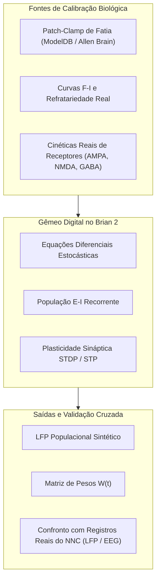
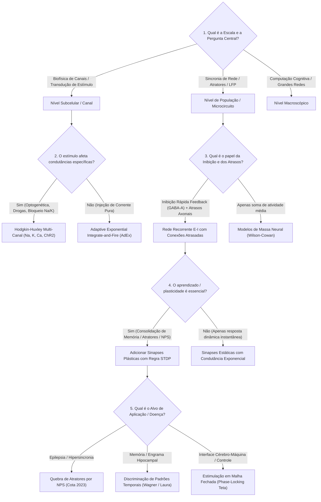

# GUIA METODOLÓGICO: TRANSIÇÃO COMPUTACIONAL E PIPELINE DE DECISÃO NO BRIAN 2
## Abordagem de Engenharia de Sistemas para o PPGEE / NNC (UFMG)

---

## 1. Avaliação Crítica da Situação Experimental de Bancada

### 1.1. Diagnóstico da Quebra Metodológica
Na experimentação animal clássica com cirurgia estereotáxica, o protocolo científico exige que a **confirmação histológica pós-operatória** (identificação do trajeto da ponta do eletrodo no atlas de Paxinos & Franklin) seja o controle obrigatório da **variável independente**:
* Se os cérebros anteriores não atingiram a coordenada exata de CA3 e as levas subsequentes não foram fatiadas, **a localização física do estímulo torna-se indeterminada**.
* Em termos de projeto de engenharia: aplicou-se uma perturbação $u(t)$ em um nó não identificado de uma planta desconhecida. Qualquer medida de saída $y(t)$ (como tempo de exploração de objetos no protocolo Dix & Aggleton) perde o nexo de causalidade científica com a estrutura "CA3".
* **Conclusão Técnica**: Tentar forçar a interpretação desses dados como "efeitos da estimulação em CA3" violaria a integridade metodológica e seria sumariamente rejeitado por qualquer banca de pós-graduação.

### 1.2. Decisão Estratégica sobre os Vídeos Não Processados
* Processar dezenas de gigabytes de vídeo no **Behavython / DeepLabCut** sem o suporte histológico de localização do eletrodo representaria desperdício de tempo computacional e cognitivo para a tese principal.
* **Destino Metodológico Correto**:
  * Utilizar uma amostra desse material no capítulo ou apêndice de **Metodologia Experimental e Análise Crítica de Protocolo** da dissertação.
  * Demonstrar o domínio do pipeline de visão computacional (rastreamento de partes corporais via DeepLabCut, cálculo de centróides e zonas de interação), articulando por que o controle histológico é um gargalo crítico em ensaios *in vivo*. Isso transforma o erro experimental em demonstração técnica de rigor e maturidade científica.

### 1.3. A Decisão de Abandonar o Comportamento *In Vivo*
* O condicionamento comportamental clássico em roedores apresenta dezenas de variáveis intervenientes incontroláveis (olfato residual, estresse de contenção, ritmos ultradianos, variações de iluminação).
* Para um Engenheiro Mecatrônico no PPGEE, migrar para a **Neurociência Computacional / Neuroengenharia de Sistemas Dinâmicos** (como fez João Pedro Carvalho Moreira na modelagem e eletrofisiologia da epilepsia com o Prof. Márcio) é a transição mais sólida e alinhada à área de concentração de Inteligência Computacional (Prof. Hani Yehia).

---

## 2. Como Tornar Modelos no Brian 2 Plausíveis e Validados *In Vivo*

Para evitar que uma simulação seja apenas um "constructo puramente matemático sem relevância biológica", o ecossistema do Brian 2 utiliza quatro âncoras de calibração empírica:

1. **Parâmetros de Canais Extraídos de Repositórios Globais**:
   * Utilizar cinéticas biofísicas já quantificadas em fatias hipocampais de camundongos disponíveis no **ModelDB** (ex: modelo de CA3 de Hemond et al., 2008; Cutsuridis et al., 2010).
2. **Calibração pela Curva Frequência-Corrente ($f-I$)**:
   * O neurônio no Brian 2 deve reproduzir rigorosamente a taxa de disparo em resposta a degraus de corrente ($100\text{ pA}$ a $500\text{ pA}$) idêntica à de uma célula piramidal de CA3 real (adaptação de frequência via canais de potássio lentos dependentes de cálcio, $I_{AHP}$).
3. **Síntese de LFP Populacional**:
   * O Brian 2 calcula a soma ponderada das correntes transmembrana de toda a população ($\text{LFP} \propto \sum I_{\text{mem}}$).
   * Esse sinal sintético é comparado diretamente com os sinais históricos de LFP gravados no NNC (espectrogramas teta, harmônicos e supressão de potência).
4. **Análise de Sensibilidade Paramétrica**:
   * O modelo deve demonstrar estabilidade estrutural: suas conclusões devem se manter mesmo se as condutâncias variarem em $\pm 10\text{--}20\%$ (evitando soluções ajustadas artificialmente).

---

## 3. Literatura Científica Canônica do Brian 2

Os artigos seminais do simulador fornecem a base teórica para a modelagem:

1. **Goodman & Brette (2008)** — *The Brian simulator* (*Frontiers in Neuroinformatics*):
   * Introduziu o paradigma de modelos definidos por equações diferenciais em texto explícito com **verificação dimensional estrita de grandezas físicas** (impedindo incompatibilidades entre voltagem, corrente e condutância).
2. **Brette et al. (2007)** — *Simulation of networks of spiking neurons: A review of tools and strategies* (*J. Comput. Neurosci.*):
   * Demonstrou as estratégias de validação cruzada entre simuladores (Brian, NEURON, NEST) e os limites biofísicos de modelos simplificados versus modelos de Hodgkin-Huxley.
3. **Stimberg, Brette & Goodman (2019)** — *Brian 2, an intuitive and efficient neural simulator* (*eLife*, 8:e47314):
   * Artigo canônico atual. Introduziu o compilador de código C++ Standalone (OpenMP), viabilizando simulações de redes em grande escala com desempenho comparável a código nativo em C, mantendo a flexibilidade para definir condutâncias dinâmicas customizadas (como fotocorrentes optogenéticas e microeletrodos).
4. **Stimberg et al. (2014)** — *Modeling neuron–glia interactions with the Brian 2 simulator* (*Frontiers in Neuroinformatics*):
   * Formalizou a extensão para acoplamento dinâmico entre variáveis de estado neuronais e cascatas bioquímicas extraneuronais.

---

## 4. Pipeline de Decisão Arquitetural no Brian 2 (Árvore de Decisão)

A árvore abaixo orienta a escolha do modelo ideal para qualquer pergunta científica em neuroengenharia:

---

## 5. Tabela de Seleção Rápida de Componentes no Brian 2

| Necessidade da Pesquisa | Modelo Neuronal Recomendado no Brian 2 | Custo Computacional | Justificativa de Engenharia |
| :--- | :--- | :--- | :--- |
| **Transdução Optogenética vs Elétrica** | Hodgkin-Huxley com equações diferenciais contínuas | Alto ($dt = 0{,}02\text{ ms}$) | Necessário para capturar o tempo de abertura/fechamento das portas iônicas ($m, h, n, g_{\text{ChR2}}$). |
| **Redes de CA3 com 1.000 a 10.000 neurônios** | Izhikevich ou AdEx (*Adaptive Exponential*) | Médio-Baixo ($dt = 0{,}1\text{ ms}$) | Reproduz disparo em rajada (*bursting*), adaptação de frequência e ressonância com custo $10\times$ menor que HH. |
| **Plasticidade Sináptica (STDP)** | `Synapses` com equações de traço dirigidas a eventos (`event-driven`) | Baixo | Permite atualizar pesos apenas quando há disparos, acelerando a simulação em redes densas. |
| **Comparação com LFP de Laboratório** | Monitoramento de $\sum g_{\text{AMPA}} + \sum g_{\text{GABA}}$ filtrado | Mínimo | Permite extrair o LFP sintético da população e aplicar FFT / Transformada de Wavelet para confronto direto com registros do NNC. |
