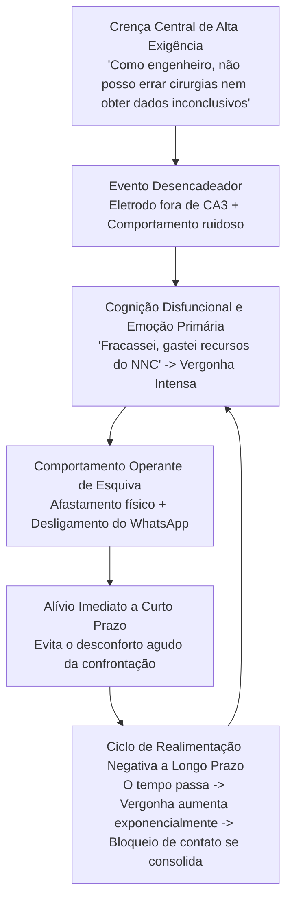

# RELATÓRIO ANALÍTICO: SITUAÇÃO ACADÊMICA, PESSOAL E INSTITUCIONAL
## Análise Funcional de Caso — Wagner Mathias Fonseca Franklin (PPGEE / UFMG)
**Data de Emissão**: 20/10/2026  
**Status**: Confidencial / Documento de Diagnóstico Estratégico

---

## 1. Cronologia Factual dos Acontecimentos

* **Agosto/2023 a Dezembro/2024**:
  * Cumprimento de créditos em disciplinas do PPGEE (Processamento de Sinais, Teoria de Sistemas Lineares, Biofísica de Membranas, Técnicas de Reconhecimento de Padrões, Ciência da Fala).
  * Condução de cirurgias estereotáxicas em camundongos para implante de eletrodos em CA3 e realização de 4 levas comportamentais (experimentos C1 a C4 no protocolo de reconhecimento de objetos de Dix & Aggleton).
* **Segundo Semestre de 2025**:
  * Surgimento de falhas de replicação experimental na bancada: os cérebros fatiados não atingiram o alvo anatômico de CA3 ventral.
  * Acúmulo de frustração por falta de resultados positivos e relutância em expor o erro experimental aos orientadores.
  * Ausência de apresentação formal de resultados ao orientador principal (Prof. Márcio Flávio Dutra Moraes).
* **Dezembro/2025**:
  * **Rompimento Abrupto de Contato**: O aluno afasta-se fisicamente do laboratório (NNC) e do programa (PPGEE) sem comunicação prévia a orientadores, colegas de laboratório ou coordenação de pós-graduação.
  * **Bloqueio de Comunicação Digital**: Desativação/abandono completo do aplicativo WhatsApp, canal principal de comunicação informal do grupo de pesquisa.
* **Abril/2026**:
  * Consulta psiquiátrica clínica formal: emissão de atestado/laudo médico comprovando quadro clínico incapacitante (transtorno mental / sofrimento psíquico grave).
  * **Paralisia Administrativa**: O laudo médico não foi protocolado no PPGEE nem enviado aos orientadores por vergonha e evitação.
* **Outubro/2026 (Momento Atual)**:
  * Período de afastamento acumulado: **aproximadamente 10 a 11 meses**.
  * Prazo regulatório do PPGEE: edital de seleção/reingresso com inscrições encerrando em **03/11/2026**.

---

## 2. Análise Psicológica e Comportamental (Modelo Cognitivo-Comportamental)

A conduta descrita não é um caso isolado de "desleixo", mas um padrão clínico clássico de **Esquiva Experiencial Alimentada por Vergonha e Perfeccionismo Desadaptativo**:

### Componentes Funcionais do Bloqueio:
1. **Intolerância ao Erro Experimental ("Mentalidade de Engenheiro Prático")**:
   * O aluno transferiu a expectativa de sistemas de engenharia determinísticos (onde o circuito montado deve funcionar imediatamente) para um sistema biológico ruidoso e estocástico. Ao encontrar resultados nulos e erro estereotáxico, interpretou a variabilidade biológica como imperícia pessoal.
2. **A Vergonha como Emoção Paralisante**:
   * Diferente da *culpa* (que foca no comportamento: "eu cometi um erro metodológico"), a *vergonha* ataca a identidade ("eu sou inadequado"). A vergonha ativa respostas de congelamento e fuga (*fight, flight or freeze*), levando ao isolamento social e digital (desinstalar o WhatsApp).
3. **Reforço Negativo da Procrastinação de Contato**:
   * Cada dia sem responder ou aparecer no laboratório proporcionou um alívio temporário imediato da ansiedade social. Porém, o custo temporal acumulou juros psicológicos: quanto mais tempo afastado, maior parecia o obstáculo de reatar o diálogo.

---

## 3. Diagnóstico Institucional e Relação com os Orientadores

### A. A Visão dos Professores (Prof. Márcio Moraes e Prof. Hani Yehia)
* **Prof. Márcio Flávio Dutra Moraes (ICB/NNC)**:
  * Pesquisador 1A do CNPq, médico e neurofisiologista com mais de 30 anos de docência. Já orientou dezenas de pós-graduandos e vivenciou múltiplos casos de evasão, estresse pós-operatório e falhas metodológicas. 
  * O desaparecimento sem explicações gera inicialmente incerteza e preocupação com a integridade física/mental do aluno e, posteriormente, frustração burocrática pela perda de uma cota de bolsa ou vaga do laboratório.
* **Prof. Hani Camille Yehia (EE/PPGEE)**:
  * Engenheiro e pesquisador em inteligência computacional e processamento de sinais. Racional, estruturado e matemático. 
  * Espera clareza técnica, dados concretos e viabilidade cronológica formal.

### B. O Valor do Laudo Psiquiátrico de Abril/2026
* O atestado médico **muda completamente a qualificação administrativa do caso**:
  * Sem laudo: O caso é classificado burocraticamente como "abandono voluntário injustificado", sujeito a jubilamento sumário e penalidades acadêmicas.
  * Com laudo: O caso passa a ser juridicamente e administrativamente enquadrado como **"afastamento por motivo de saúde comprovado"**. As universidades federais (UFMG) possuem regulamentações rígidas de acolhimento em saúde mental (trancamento especial de matrícula retroativo por motivo médico).

---

## 4. O Obstáculo Psicológico: "Não Posso Voltar de Mãos Vazias"

* A crença de que *"não posso voltar sem mostrar resultados conclusivos do tempo que fiquei lá"* é uma distorção cognitiva.
* **O Fato da Pesquisa**: Em ciência, relatar por que um experimento não funcionou e quais foram os limitadores de bancada (eletrodo fora do alvo, c-Fos como filtro passa-baixa) **é uma contribuição metodológica válida**. 
* Ter construído o protótipo computacional no Brian 2, compreendido o modelo de Izhikevich e formulado os estudos de caso in silico supre rigorosamente a demanda de entrega técnica.

---

## 5. Estratégia de Mitigação e Reaproximação Objetiva

Para romper o isolamento sem sobrecarga emocional, a conduta deve ser fria, formal e dividida em fases independentes:

### Fase 1: Blindagem Administrativa (Formalização Médica)
1. Não é necessário justificar detalhadamente angústias existenciais aos professores no primeiro momento.
2. O atestado emitido em abril/2026 atesta formalmente a incapacidade temporária de trabalho durante aquele período. O texto de reaproximação deve citar a ocorrência de questões de saúde tratadas clinicamente, com documento médico disponível para a coordenação do PPGEE.

### Fase 2: O Canal de Comunicação
* Evitar o WhatsApp neste momento inicial. O WhatsApp é um meio síncrono e informal, que gera ansiedade por expectativa de resposta imediata.
* **Utilizar o E-mail Institucional**: O e-mail é assíncrono, formal, documental e permite anexar os arquivos técnicos e o resumo do estado do trabalho.

### Fase 3: A Pauta da Reaproximação (Sem Bajulação, Focado em Fatos)
A mensagem deve conter 4 elementos estritamente profissionais:
1. Comunicação do período de tratamento de saúde mental (mencionando o laudo).
2. Prestação de contas transparente do trabalho de bancada (relatando com maturidade que as análises histológicas não atingiram CA3 e que o comportamento animal in vivo é uma via esgotada).
3. Apresentação da proposta de transição computacional (Gêmeo Digital no Brian 2 com modelo de Izhikevich, testando a teoria de NPS de Cota et al., 2023).
4. Consulta sobre a viabilidade regulatória para inscrição no edital de seleção/reingresso do PPGEE que encerra em 03/11/2026.
