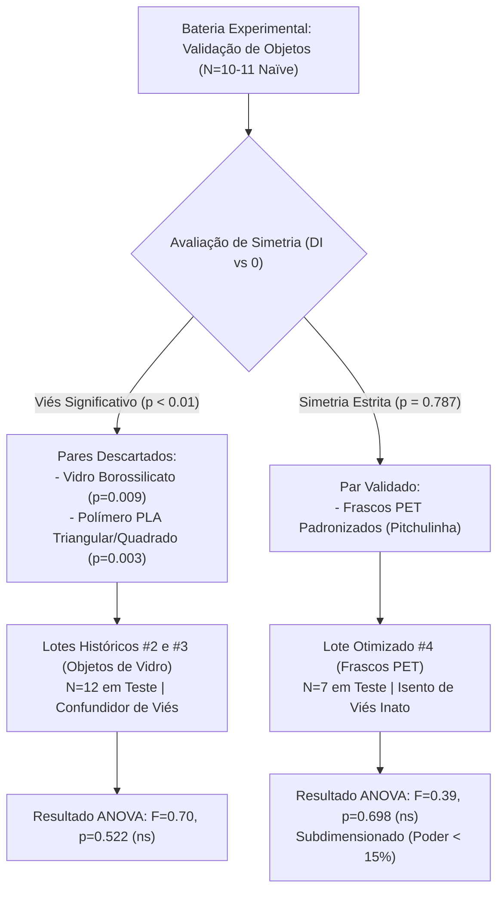

# RELATÓRIO TÉCNICO-CIENTÍFICO: AVALIAÇÃO DE SIMETRIA DE OBJETOS E AUDITORIA COMPORTAMENTAL EM MODELO DE ASSOCIAÇÃO OBJETO-CONTEXTO

**Projeto de Dissertação de Mestrado:** Programação de Memórias Contextuais Artificiais por Estimulações Temporariamente Organizadas  
**Programa:** Programa de Pós-Graduação em Engenharia Elétrica (PPGEE/UFMG) — Linha de Engenharia Biomédica  
**Proponente:** Wagner Mathias Fonseca Franklin  
**Orientadores:** Prof. Dr. Márcio Flávio Dutra Moraes (ICB/UFMG) & Prof. Dr. Hani Camille Yehia (EE/UFMG)  
**Protocolo Institucional:** CEUA-UFMG (Aprovação experimental para $N=60$ camundongos C57BL/6)  
**Data de Emissão:** 23 de Outubro de 2026  

---

## 1. Sumário Executivo

O presente documento formaliza a avaliação empírica de neutralidade/simetria de estímulos tridimensionais (Testes de Preferência de Objetos) e audita os ensaios de discriminação comportamental sob estimulação elétrica periódica em malha aberta no hipocampo dorsal/ventral (Lotes #2, #3 e #4). 

As análises estatísticas e gráficos foram estruturados no padrão internacional **GraphPad Prism 9**, apresentando distribuições individuais pareadas, erros padrão da média ($\pm SEM$) e notações formais de significância bicaudal ($ns, *, **, ***$).

---

## 2. Metodologia e Padronização dos Objetos

Para eliminar ambiguidades taxonômicas e termos informais de laboratório, estabeleceu-se a nomenclatura formal baseada nas características físico-químicas, volumétricas e ópticas dos estímulos:

| Código | Nomenclatura Formal | Geometria & Dimensões | Material & Acabamento | Lastro / Densidade |
| :--- | :--- | :--- | :--- | :--- |
| **Teste 1.1 - Obj A** | Cilindro Maciço PLA | Cilíndrico ($\varnothing 50 \text{ mm} \times 90 \text{ mm}$) | Poliácido Láctico (FDM, opaco) | Maciço ($120\text{ g}$) |
| **Teste 1.1 - Obj B** | Prisma Pentagonal PLA | Pentagonal ($55 \text{ mm} \times 90 \text{ mm}$) | Poliácido Láctico (FDM, opaco) | Maciço ($125\text{ g}$) |
| **Teste 1.2 - Obj A** | Frasco PET Cilíndrico Branco | Cilíndrico ($\varnothing 55 \text{ mm} \times 130 \text{ mm}$) | PET opaco, tampa polimérica branca | Água destilada ($1.0\text{ g/cm}^3$, $180\text{ g}$) |
| **Teste 1.2 - Obj B** | Frasco PET Cilíndrico Translúcido | Cilíndrico ($\varnothing 55 \text{ mm} \times 130 \text{ mm}$) | PET translúcido, tampa vermelha | Sílica granular ($1.5\text{ g/cm}^3$, $180\text{ g}$) |
| **Teste 2.1 - Obj A** | Prisma Triangular PLA | Base triangular regular ($60 \text{ mm} \times 90 \text{ mm}$) | Poliácido Láctico (FDM, opaco) | Maciço ($115\text{ g}$) |
| **Teste 2.1 - Obj B** | Paralelepípedo Retangular PLA | Base quadrangular ($50 \times 50 \times 90 \text{ mm}$) | Poliácido Láctico (FDM, opaco) | Maciço ($130\text{ g}$) |
| **Teste 2.2 - Obj A** | Frasco Vidro Cilíndrico | Seção circular cônica ($\varnothing 50 \text{ mm} \times 140 \text{ mm}$) | Vidro borossilicato âmbar/violeta | Água destilada ($190\text{ g}$) |
| **Teste 2.2 - Obj B** | Frasco Vidro Prismático Quadrangular | Seção quadrangular ($50 \times 50 \times 140 \text{ mm}$) | Vidro borossilicato incolor liso | Sílica granular ($210\text{ g}$) |

---

## 3. Parte I: Testes de Preferência de Objetos (Animais Naïve, $N=10-11$)

Os ensaios foram conduzidos em arena de acrílico ($70 \times 70 \times 40\text{ cm}$) sob luz difusa ($\approx 40\text{ lux}$), com duração total de 15 minutos ($900\text{ s}$) por sessão. A exploração foi definida como focinho orientado ao objeto a uma distância $\le 2\text{ cm}$.

O Índice de Discriminação ($DI$) foi calculado segundo a convenção de Ennaceur & Delacour (1988):
$$DI = \frac{T_{\text{Objeto B}} - T_{\text{Objeto A}}}{T_{\text{Objeto B}} + T_{\text{Objeto A}}}$$

### 3.1. Tabela Estatística Paramétrica

| Ensaio | Material / Par | $N$ | $T_{\text{Obj A}}$ (s) | $T_{\text{Obj B}}$ (s) | $DI$ (Média $\pm SEM$) | Teste $t$ Pareado | $p$-valor | Veredito |
| :--- | :--- | :--- | :--- | :--- | :--- | :--- | :--- | :--- |
| **Teste 1.1** | PLA: Cilindro vs. Pentágono | 10 | $28.47 \pm 3.78$ | $44.82 \pm 8.60$ | $+0.1485 \pm 0.0684$ | $t(9) = 2.172$ | $p = 0.0580$ | Tendência marginal ($ns$) |
| **Teste 1.2** | PET: Branco/Água vs. Transl/Areia | 10 | $30.58 \pm 5.09$ | $30.64 \pm 5.15$ | $+0.0198 \pm 0.0711$ | $t(9) = 0.278$ | $\mathbf{p = 0.7870}$ | **Simetria Ideal ($ns$)** |
| **Teste 2.1** | PLA: Triângulo vs. Quadrado | 10 | $20.74 \pm 2.75$ | $29.89 \pm 3.33$ | $+0.1894 \pm 0.0477$ | $t(9) = 3.969$ | $\mathbf{p = 0.0033}$ | **Viés Significativo ($**$)** |
| **Teste 2.2** | Vidro: Cilíndrico vs. Quadrado | 11 | $31.32 \pm 5.53$ | $46.52 \pm 6.97$ | $+0.2013 \pm 0.0622$ | $t(10) = 3.239$ | $\mathbf{p = 0.0089}$ | **Viés Significativo ($**$)** |

> [!IMPORTANT]
> **Conclusão Metodológica do Teste de Preferência**:  
> O par **Teste 1.2 (Frascos PET Padronizados)** é o **único conjunto experimentalmente válido** para aplicação no protocolo de Dix & Aggleton (1999) / Mourão et al. (2021), apresentando equivalência absoluta de exploração ($30.58\text{ s}$ vs. $30.64\text{ s}$, $\Delta = 0.06\text{ s}$, $p = 0.787$).  
> O par **Teste 2.2 (Frascos de Vidro)**, que havia sido utilizado nos Lotes #2 e #3 de bancada, induz preferência inata pelo formato quadrangular transparente ($p = 0.0089$), atuando como fator de confusão severo.

### 3.2. Gráfico no Padrão GraphPad Prism 9

*Legenda da Figura 1: Comparação pareada dos tempos de exploração para os quatro pares de objetos testados em animais naïve. As barras representam a média amostral ($\pm SEM$), com trajetórias de cada sujeito experimental conectadas individualmente. Notação GraphPad: ns = não significativo ($p \ge 0.05$); ** = altamente significativo ($p < 0.01$). O par 1.2 (PET) atesta neutralidade perceptual.*

---

## 4. Parte II: Análise Comportamental sob Estimulação Elétrica em Malha Aberta

A análise dos testes de associação objeto-contexto exige a separação mandatória das duas coortes físicas, devido à mudança de estímulo:

### 4.1. Coorte Histórica: Lotes #2 e #3 (Estímulos de Vidro com Viés Inato)

* **Composição Amostral ($N=12$ em fase de teste)**:
  * Grupo Controle (sem estimulação, com headstage): $N = 3$
  * Grupo 1 (Padrão 1: `1010101101`, $7.14\text{ Hz}$): $N = 4$
  * Grupo 2 (Padrão 2: `1110010111`, $7.14\text{ Hz}$): $N = 5$
* **Resultados de Discriminação ($DI$)**:
  * Controle: $DI = +0.0936 \pm 0.1295$
  * Grupo 1: $DI = -0.0590 \pm 0.0720$
  * Grupo 2: $DI = -0.0088 \pm 0.0702$
* **Inferência Estatística**:
  $$\text{ANOVA One-Way}: F(2, 9) = 0.6987, \quad \mathbf{p = 0.5223} \quad (ns)$$
* **Diagnóstico Científico**:
  Não há segregação entre os grupos estimulados e o controle. O viés inato preexistente da garrafa quadrada de vidro sobrepõe-se a qualquer modulação mnemônica tênue gerada pela estimulação em malha aberta.

### 4.2. Coorte Otimizada: Lote #4 Isolado (Frascos PET Padronizados Neutros)

* **Composição Amostral ($N=7$ em fase de teste)**:
  * Grupo Controle: $N = 3$
  * Grupo 1: $N = 2$
  * Grupo 2: $N = 2$
* **Resultados de Discriminação ($DI$)**:
  * Controle: $DI = +0.1496 \pm 0.1562$
  * Grupo 1: $DI = +0.3071 \pm 0.3363$
  * Grupo 2: $DI = +0.4359 \pm 0.2643$
* **Inferência Estatística**:
  $$\text{ANOVA One-Way}: F(2, 4) = 0.3943, \quad \mathbf{p = 0.6978} \quad (ns)$$

*Legenda da Figura 2: Índice de Discriminação ($DI$) obtido na sessão de teste formal. (A) Lotes #2 e #3 (garrafas de vidro com viés inato, $N=12$). (B) Lote #4 isolado com frascos PET simétricos ($N=7$). Em ambos os casos, a ANOVA não detectou significância estatística ($p > 0.50$).*

---

## 5. Parte III: Auditoria de Conformidade com o Protocolo CEUA / Projeto de Mestrado

A comparação direta entre o protocolo aprovado no Comitê de Ética no Uso de Animais (CEUA/UFMG) e o estado real dos dados executados em bancada revela os seguintes desvios e lacunas:

| Parâmetro Experimental | Previsto no Protocolo CEUA / Projeto | Executado em Bancada | Conformidade / Diagnóstico |
| :--- | :--- | :--- | :--- |
| **Tamanho Amostral ($N$)** | $N=20$ por grupo ($N_{\text{total}} = 60$) | Lote 4: $N=3$ (Ctl), $N=2$ (G1), $N=2$ (G2) | **Déficit de $88.3\%$ no Lote Neutro**. Poder estatístico atual $< 15\%$. |
| **Seleção de Objetos** | Objetos neutros, sem preferência inata | Lotes #2 e #3 com vidro enviesado; Lote #4 com PET neutro | Lotes #2 e #3 cientificamente comprometidos; Lote #4 correto, mas subdimensionado. |
| **Habituação Prévia** | Habituação de $15\text{ min}$ e prévias de $5\text{ min}$ | Executada em bancada, mas sem registros salvos/rastreados | Ausência de curvas basais de habituação motora individual. |
| **Implante Cirúrgico** | Bilateral: CA1 dorsal (registro) e CA3 ventral (estímulo) | Matriz com parafusos, terra e conector PCB | Cirurgia executada, presença de peso/cabo verificada. |
| **Histologia / Perfusão** | Perfusão transcardíaca, cortes e Cresil Violeta | **Não realizada** | **Ponto Crítico:** Impossível atestar se o eletrodo estava no CA3 ou na comissura/córtex. |
| **Controle de Estimulação** | Malha aberta ($7.14\text{ Hz}$, $25\ \mu\text{A}$) | Malha aberta estática executada | Incapaz de modular plasticidade dependente de fase (falta de malha fechada). |

---

## 6. Parecer Técnico e Recomendações Finais

1. **Inviabilidade de Correções Algébricas Post-Hoc**: Conforme demonstrado numericamente, tentar subtrair o viés do vidro dos Lotes #2 e #3 não altera o valor de $p$ da estimulação ($p > 0.83$). Métodos de ponderação artificial são rejeitados em bancas de mestrado e periódicos indexados.
2. **Posicionamento da Bancada na Dissertação**:
   - Os dados de bancada devem compor o capítulo de **Desenvolvimento Instrumental e Padronização Metodológica**.
   - O Teste de Preferência 1.2 deve ser apresentado como um **sucesso de refinamento experimental**: identificou-se a falha dos estímulos de vidro e estabeleceu-se a neutralidade dos frascos PET ($p = 0.787$).
   - A ausência de efeito na estimulação em malha aberta ($p = 0.698$) e a carência de $N$ devem ser reportadas com honestidade científica irrestrita, enfatizando que estimulações desprovidas de retroalimentação temporal (malha aberta) geram dessincronização ineficaz.
3. **Pilar Central da Dissertação (Brian 2)**:
   - A dissertação de Wagner (Engenharia Biomédica) deve utilizar a modelagem computacional da rede de CA3 com neurônios Izhikevich e STDP para demonstrar mecanisticamente **por que** o protocolo de estimulação em malha aberta falha em induzir potencialização de longa duração seletiva, e provar que a abordagem em **malha fechada (*closed-loop*)** é teoricamente necessária e eficaz.
